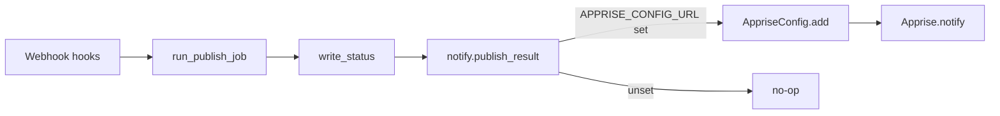

# Add Apprise notifications

Wire [Apprise](https://github.com/caronc/apprise) into the FastAPI publish path so webhook jobs can alert Discord/Slack/Telegram/etc. when a publish finishes.

## Approach

- **Events**: notify on both **success** and **failure** after `write_status()` in [`run_publish_job()`](backend/main.py)
- **Config**: `APPRISE_CONFIG_URL` — one [Apprise configuration URL](https://github.com/caronc/apprise/wiki/config) (local file path, `file://…`, or `https://…` including Apprise API `/get/{key}`). Empty/unset = no-op
- **Scope**: FastAPI webhook path only (`/hooks/apk`, `/hooks/eas`, `/hooks/publish`); shell one-shot `publish` profile stays silent

Service URLs (`discord://…`, etc.) live *inside* that config, not as env vars — so secrets and multi-channel routing stay in one place Apprise already understands.



## Implementation

### 1. Dependency

Add `apprise` to [`backend/requirements.txt`](backend/requirements.txt).

### 2. Helper — [`backend/notify.py`](backend/notify.py) (new)

Small module:

- Read `APPRISE_CONFIG_URL` (and optional `REPO_NAME` for message titles)
- If unset/blank, all notify calls are no-ops
- Lazy-build: `AppriseConfig().add(config_url)` then `Apprise().add(config)` (reload per notify or cache once — prefer cache on first use; failures logged, not raised)
- `notify_publish_result(status, trigger, message, exit_code=None, log_tail=None)`:
  - Title like `[REPO_NAME] Publish succeeded` / `Publish failed`
  - Body: trigger, message, optional exit code, short log tail on failure (~500 chars)
  - Run Apprise in a thread via `asyncio.to_thread` so the event loop is not blocked
  - Swallow Apprise errors (log to stderr); never fail the publish HTTP response because notify failed

### 3. Hook into publish — [`backend/main.py`](backend/main.py)

After each `write_status(...)` for success, script failure, and exception failure inside `run_publish_job`, call the notifier. Do not notify on the `"running"` status.

### 4. Config + docs

- [`.env.example`](.env.example) — new section:

```bash
# -- Notifications (Apprise) -------------------------------------------------
# Apprise configuration URL (file path, file://, or https://). Leave blank to disable.
# See: https://github.com/caronc/apprise/wiki/config
# Examples:
#   /data/apprise.yml
#   https://apprise.example.com/get/YOUR_KEY
APPRISE_CONFIG_URL=""
```

- [`README.md`](README.md) — short note under Environment that publish jobs notify when `APPRISE_CONFIG_URL` is set, linking to Apprise config docs.

## Out of scope

- Embedding service URLs directly in env (`APPRISE_URLS`)
- Notifications from bare-metal `scripts/publish.sh` / boot rebuild in `start.sh`
- Admin UI or per-org notification settings
