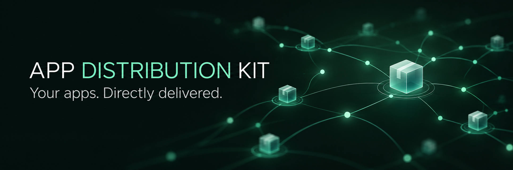

<p align="center">
  
</p>

# App Distribution Kit

Run your own Android app distribution endpoint. App Distribution Kit accepts signed APKs through authenticated webhooks, builds a signed F-Droid repository, and gives every app a clean, shareable download page.

It works as a long-lived Docker service with one persistent data volume. Keep everything on your own server, publish to S3-compatible storage, or use both.

## What you get

- A signed, F-Droid-compatible repository
- A lightweight app catalog at `/`
- Shareable latest-release pages at `/apps/{bundle-id}`
- F-Droid deep links and direct APK downloads
- Authenticated APK, publish, and EAS Build webhooks
- Self-hosted, S3-compatible, and mirrored deployment modes

## Deployment modes

| Mode | Configuration | Client `REPO_URL` | Behavior |
| --- | --- | --- | --- |
| **Self-hosted** | `SELF_HOST=true` or incomplete S3 variables | `http://host:8000/fdroid/repo` | Generate and serve `data/repo/` locally |
| **S3 primary** | All `S3_*` variables set and `SELF_HOST` is not true | Public bucket or R2 URL | Ingest, build, then run `fdroid deploy` |
| **Self-hosted + mirror** | `SELF_HOST=true` and S3 configured | Local `/fdroid/repo` | Serve locally and mirror to S3 |

The default is self-hosted mode: `SELF_HOST=true` with blank S3 credentials.

## Quick start

```bash
cp env.example .env
# Set WEBHOOK_TOKEN, REPO_URL, and optionally S3_* / SELF_HOST

mkdir -p data
docker compose up --build -d
```

Open these routes after the service starts:

| Route | Purpose |
| --- | --- |
| `http://localhost:8000/` | App catalog, source link, and F-Droid deep link |
| `http://localhost:8000/apps/<bundle-id>` | Latest release with F-Droid and direct APK links |
| `http://localhost:8000/fdroid/repo/` | Self-hosted F-Droid repository |
| `http://localhost:8000/health` | Health check |
| `http://localhost:8000/api/status` | Latest publish status |

The service uses one volume, `./data:/data`, for APKs, metadata, repository files, signing keys, generated configuration, and status.

## Publish an app

Upload a signed APK and rebuild the repository:

```bash
curl -X POST "http://localhost:8000/hooks/apk" \
  -H "Authorization: Bearer $WEBHOOK_TOKEN" \
  -F "file=@app-release.apk"
```

Rebuild or deploy without uploading a new APK:

```bash
curl -X POST "http://localhost:8000/hooks/publish" \
  -H "Authorization: Bearer $WEBHOOK_TOKEN"
```

### EAS Build

Point an EAS Build webhook at `POST /hooks/eas`. Completed Android APK builds for `production`, `preview`, and `development` or `dev` are saved as `{displayName}_{production|preview|dev}.apk` and published. The display name comes from EAS `metadata.appName` or the app's `app.json` name.

```bash
eas webhook:create \
  --event BUILD \
  --url "https://YOUR_HOST/hooks/eas" \
  --secret "$EAS_WEBHOOK_SECRET"
```

Use the same value for `EAS_WEBHOOK_SECRET`—or `WEBHOOK_TOKEN`—on the server. EAS profiles must produce APKs with `android.buildType: "apk"`, not AABs.

### One-shot full publish

```bash
docker compose --profile publish run --rm publish
```

## Deploy on Railway

[`railway.toml`](railway.toml) builds the Dockerfile and starts the service through [`scripts/start.sh`](scripts/start.sh), just like local Docker.

On a fresh `/data` volume, the service initializes its configuration and creates a signed empty repository index before accepting traffic. An interrupted first build is retried until `repo/index-v1.jar` exists. If initialization still fails, startup stops instead of exposing an unusable repository.

On later boots, the service syncs `config.yml` from the environment. If APKs exist and repository settings changed, it rebuilds the index in the background while continuing to serve the last known-good repository. Existing APKs and signing keys under `/data` are never cleared or replaced.

1. Create a Railway service from this repository. Railway will detect the Dockerfile.
2. Attach a persistent volume at `/data`:

   ```bash
   railway volume add --mount-path /data
   ```

3. Set the following variables in Railway:

   - `WEBHOOK_TOKEN` for webhook authentication
   - `SELF_HOST=true` to serve the repository from this service, or leave S3 blank
   - `REPO_URL=https://${{RAILWAY_PUBLIC_DOMAIN}}/fdroid/repo`
   - `REPO_NAME` and any signing settings you want to customize
   - Optional `S3_*` variables for an S3 mirror or S3-primary mode

4. Deploy, then open `https://<domain>/fdroid/repo/`.

`DATA_DIR` defaults to `/data` in the image. Keep the persistent volume mounted there.

## Run on bare metal

Install `fdroidserver`, `rclone`, Android SDK build-tools with `apksigner`, and Java 17 or newer.

```bash
cp env.example .env
# Optional: export DATA_DIR=./data

./scripts/init.sh
./scripts/update.sh      # Incremental build and optional S3 deploy
# Or:
./scripts/publish.sh     # Clean rebuild and optional S3 deploy
```

Drop signed `.apk` files into `$DATA_DIR/apks/`. When `DATA_DIR` is unset, the default is `./apks`.

## Data layout

```text
data/
├── apks/              # Input APKs from webhooks or manual uploads
├── metadata/          # Per-app F-Droid YAML
├── repo/              # Generated index and APKs, served at /fdroid/repo
├── tmp/ cache/        # F-Droid scratch data
├── keystore.p12       # Repository signing key
├── config.yml         # Generated repository configuration
├── rclone.conf        # Generated when S3 is configured
├── assets/            # Optional icon overrides
├── .keystore_pass     # Auto-generated signing passwords
└── status.json        # Latest webhook publish status
```

## Scripts

| Script | Purpose |
| --- | --- |
| `scripts/init.sh` | Generate `config.yml` and `rclone.conf` from environment variables |
| `scripts/build.sh` | Copy and verify APKs, then run `fdroid update`; permits a signed empty index only with `ALLOW_EMPTY_REPO=true` |
| `scripts/deploy.sh` | Run `fdroid deploy` when S3 is configured; otherwise succeed in self-hosted mode |
| `scripts/update.sh` | Incremental initialization, build, and deploy for webhooks |
| `scripts/publish.sh` | Clean, rebuild, and deploy the full repository |
| `scripts/clean.sh` | Wipe generated state under `DATA_DIR` |
| `scripts/gensecret.sh` | Generate keystore passwords |
| `scripts/verify.sh` | Verify APK signatures |
| `scripts/keygen.sh` | Create the signing keystore |

## Configuration

See [`env.example`](env.example) for every option:

- **Mode:** `SELF_HOST`, `DATA_DIR`
- **Repository:** `REPO_NAME`, `REPO_URL`, `REPO_DESCRIPTION`, `REPO_WEB_BASE_URL`, `SOURCE_REPO_URL`
- **Signing:** `KEYSTORE_FILE`, `REPO_KEYALIAS`, `KEYSTORE_PASS`, `KEY_PASS`, `KEYDNAME`
- **Webhooks:** `WEBHOOK_TOKEN` and optional `EAS_WEBHOOK_SECRET` for `/hooks/eas`
- **Notifications:** `APPRISE_CONFIG_URL` for publish success and failure alerts. Leave it blank to disable notifications. A persistent `/data/apprise.yml` file can hold service URLs such as `discord://…`.
- **S3-compatible storage:** `S3_REMOTE_NAME`, `S3_PROVIDER`, `S3_BUCKET`, `S3_ACCESS_KEY_ID`, `S3_SECRET_ACCESS_KEY`, `S3_REGION`, `S3_ENDPOINT`

## Why App Distribution Kit?

The name says exactly what the project is without tying it to one host, one app, or even one catalog UI. F-Droid is the repository format today; direct downloads, webhooks, mirrors, and shareable app pages make the project broader than an “F-Droid server.”

For a shorter display name, **DistroKit** works well in UI and conversation while `app-distribution-kit` remains the clear repository name.
